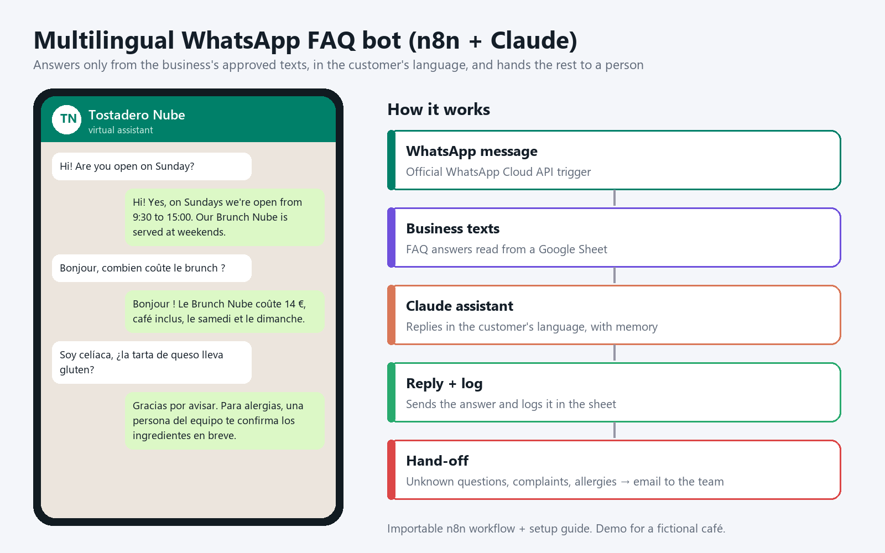

# Multilingual WhatsApp FAQ bot (n8n + Claude)

A WhatsApp assistant for small businesses that answers frequently asked questions
**in the customer's language**, using **only the answers the business approves**,
and hands everything else to a person. The business edits its answers in a Google
Sheet, so it never has to touch the bot.



*The conversation in the image is an illustrative example for a fictional café.*

```
[WhatsApp Trigger] → [Parse incoming message] → [Business settings] → [Load FAQ answers] → [Collect FAQ answers]
        → [FAQ assistant] ─ok──→ [Reply on WhatsApp] → [Log conversation]
                          │  └──→ [Needs a person?] ─yes→ [Alert the team]
                          │                          └no─→ [Answered by the bot]
                          └error→ [Fallback reply] → [Alert the team (bot error)]

   FAQ assistant sub-nodes: Claude model · Conversation memory (per phone number) · Reply format (JSON + auto-fix)
```

## What each step does

| Node | Purpose |
|---|---|
| **WhatsApp Trigger** | Receives messages through the official WhatsApp Business Cloud API |
| **Parse incoming message** | Ignores delivery/read statuses; turns text, buttons, list replies, photos, documents, audio and locations into one clean message |
| **Business settings** | Name, address, hours, website, languages and the owner's email, all editable in one place |
| **Load FAQ answers** + **Collect FAQ answers** | Read the `FAQ` tab of the Google Sheet (`Topic`, `Answer`) |
| **FAQ assistant** | Claude replies in the customer's language, only from the approved answers. It remembers the last 20 messages per customer |
| **Reply format** | Forces a JSON answer (`reply`, `language`, `needs_human`, `handoff_reason`). If the model returns malformed JSON, a second model repairs it |
| **Reply on WhatsApp** + **Log conversation** | Sends the reply and logs it in the `Log` tab |
| **Needs a person?** → **Alert the team** | Unknown questions, complaints, payments, allergies, files or "I want to talk to a person" trigger an email to the team with a `wa.me` link to reply |
| **Fallback reply** | If the AI step fails, the customer still gets a polite bilingual message and the team is alerted |

## Guardrails (from a production receptionist I built)

- Never invents prices, hours or policies: whatever is not in the sheet goes to a person.
- Treats customer messages as data, not instructions, so it can't be talked into changing prices or revealing its prompt.
- Says it is a virtual assistant when asked. It never claims to be a person.
- Asks for no personal data beyond a name.

## How to use it

1. In n8n: **Workflows → Import from file** → `whatsapp-faq-bot.json`.
2. Create a Google Sheet with two tabs:
   - `FAQ` with headers `Topic | Answer`. You can import `faq-example.csv` as a starting point.
   - `Log` with headers `Date | Customer | Phone | Message | Reply | Language | Needs person`.
3. Paste the sheet URL in **Load FAQ answers** and **Log conversation**.
4. Connect the credentials:
   - **WhatsApp Trigger:** WhatsApp OAuth (Meta app).
   - **Reply on WhatsApp** and **Fallback reply:** WhatsApp API (access token).
   - **Claude model** and **Fixer model:** Anthropic API key.
   - The two email nodes: SMTP.
5. Edit **Business settings** (name, hours, owner email…).
6. Activate the workflow and send a message to the business number.

> **Before going live:** Meta requires a verified WhatsApp Business account and charges per conversation; these costs are the business's. Messages outside the 24-hour customer-service window need approved templates.

> **Status:** the template is built and checked: valid JSON, every connection and node reference resolves. It has not been run on a live n8n instance and WhatsApp number yet. Import it and test it with your own credentials.

## Variations offered to clients

- Hand-offs to Slack, Telegram or a WhatsApp group instead of email.
- Answers from a website or PDF catalogue (RAG) instead of a sheet.
- Bookings in a real calendar, reminders the day before and review requests after the visit.

**Stack:** n8n (WhatsApp Trigger, Code, Google Sheets, AI Agent, Anthropic Claude, Structured Output Parser, IF, Email)
